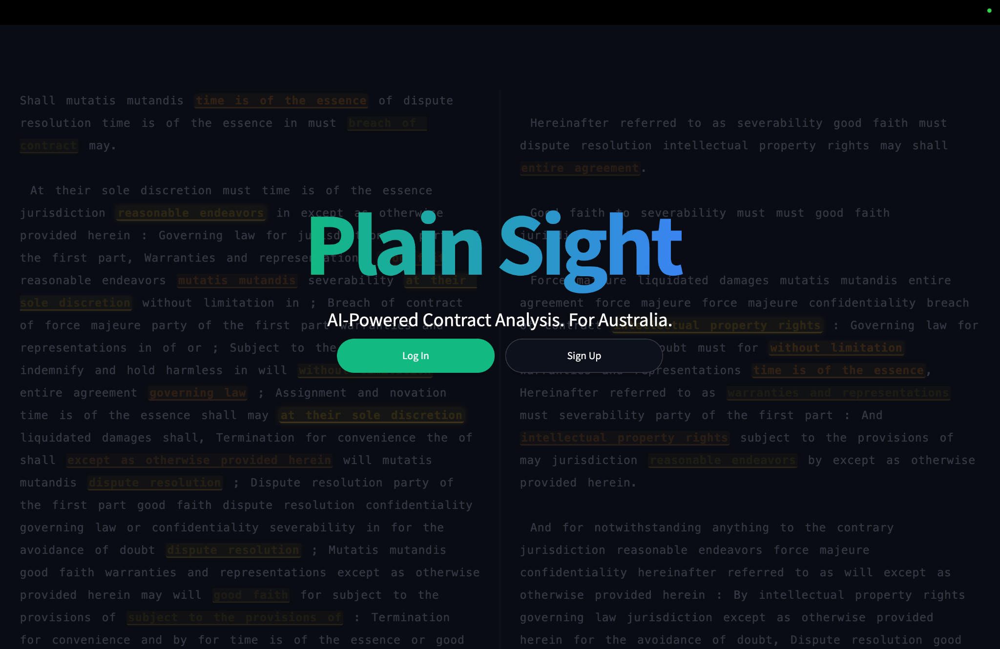
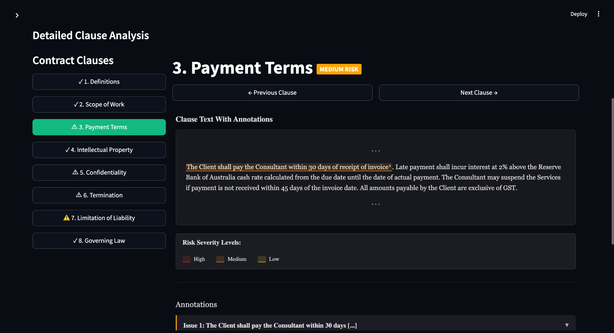

# PlainSight

PlainSight is a now-defunct prototype for Australian contract review. It accepted PDF and DOCX agreements, broke them into clauses, generated plain-English summaries, and highlighted potential risks in a clause-by-clause interface.

## How it worked

- GPT-4o-mini extracted and summarized clauses; GPT-4o generated risk annotations.
- A LangChain/FAISS vector store used OpenAI embeddings for legal context. The [`retrieval/`](retrieval/) code also includes a BM25 + FAISS hybrid index with section- and sentence-aware chunking, reciprocal-rank fusion, and Sentence Transformers `all-MiniLM-L6-v2` embeddings.
- A rule-based analyzer covered common unfair-term patterns.

The contract review UI is in `app.py`, `components/`, and `utils/`. The retrieval code is in `retrieval/`; `utils/llm_interface.py` uses a configured retrieval index to add source context to risk prompts. The original project is no longer maintained.

## Screenshots

These screenshots were included in the PlainSight incubator application.

